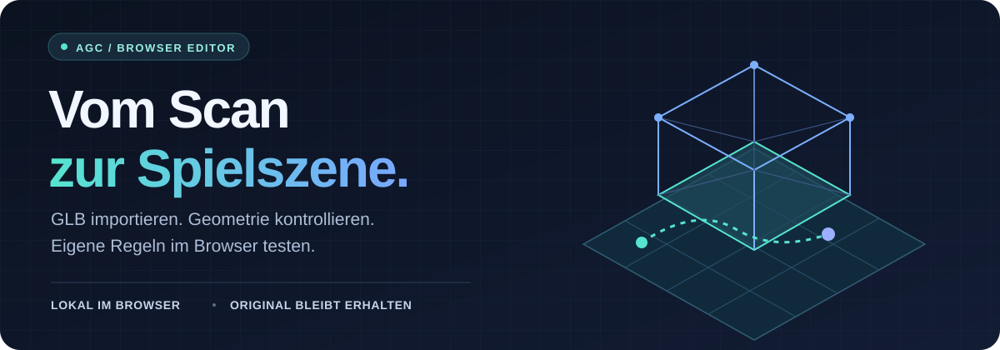
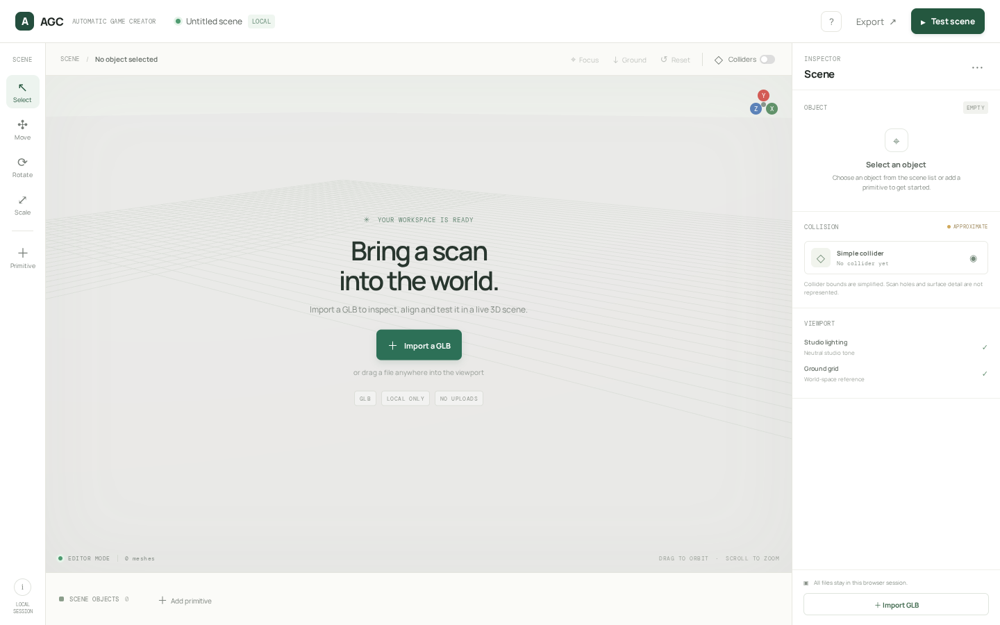
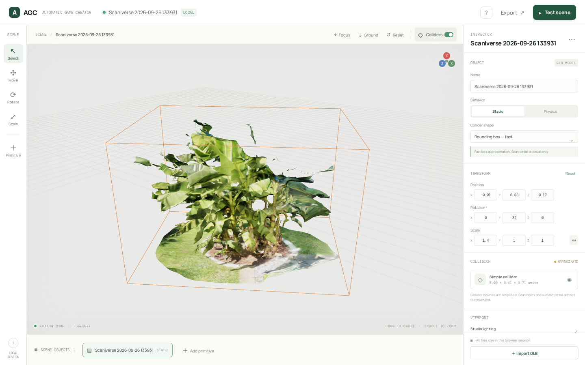
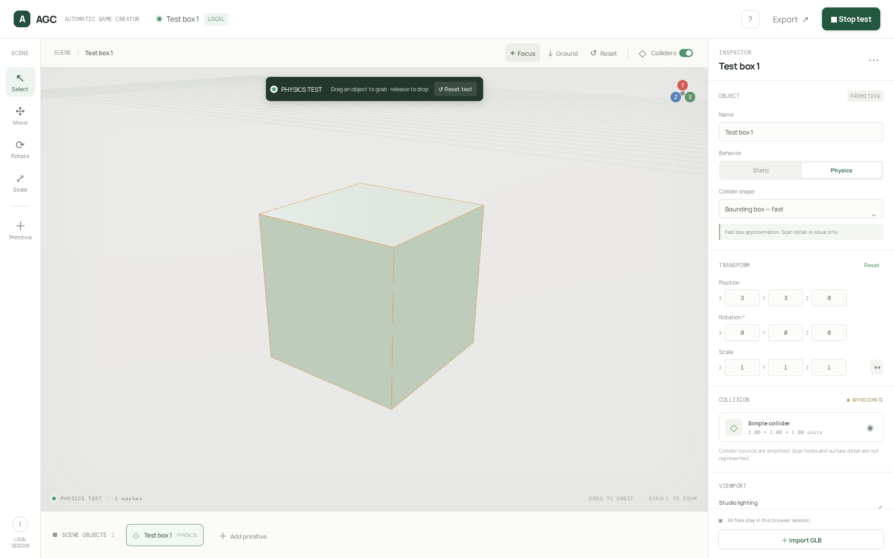
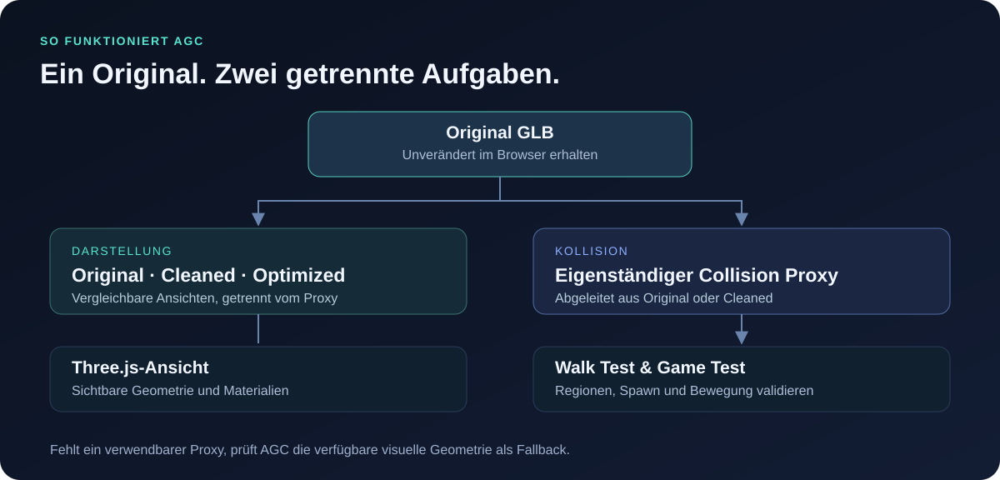
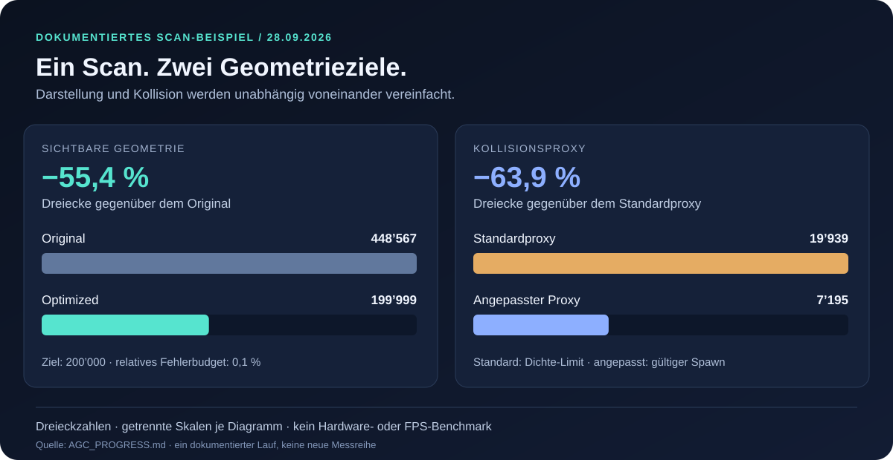

# AGC · Automatic Game Creator

<p align="center">
  
</p>

<p align="center">
  <strong>Ein lokaler Browser-Editor für interaktive 3D-Scans.</strong><br />
  Importiere eine GLB-Datei, bereite die Geometrie auf und teste deine Szene.
</p>

<p align="center">
  <a href="https://linobr.github.io/agc/"><strong>App starten ↗</strong></a>
  &nbsp;·&nbsp; <a href="#schnellstart">Lokal starten</a>
  &nbsp;·&nbsp; <a href="#geometrie-in-zahlen">Geometrie in Zahlen</a>
  &nbsp;·&nbsp; <a href="docs/TECHNICAL_GUIDE.md">Technische Referenz</a>
</p>

<p align="center">
  <a href="https://github.com/linobr/agc/actions/workflows/pages.yml"></a>
  
  
  
</p>

<table>
  <tr>
    <td width="33%" valign="top"><strong>01 · Original erhalten</strong><br /><br />Cleanup, Crops und Optimierung entstehen als abgeleitete Varianten. Die ursprüngliche GLB-Datei bleibt unverändert.</td>
    <td width="33%" valign="top"><strong>02 · Geometrie kontrollieren</strong><br /><br />Darstellung und Kollision haben eigene Ziele. Overlays zeigen Flächen, Proxy und geprüften Spawn.</td>
    <td width="33%" valign="top"><strong>03 · Gameplay ausprobieren</strong><br /><br />Trigger, Ziele und Sammelobjekte konfigurieren. Regeln direkt im Game Test erproben.</td>
  </tr>
</table>

**Navigation:** [Vorschau](#vorschau) · [Funktionsumfang](#funktionsumfang) · [Workflow](#workflow) · [Erstes Minispiel](#dein-erstes-minispiel) · [Speichern](#projekte-speichern) · [Entwicklung](#entwicklung) · [Grenzen](#status-und-grenzen)

## Vorschau

<p align="center">
  
</p>

<details>
<summary>Weitere dokumentierte Ansichten</summary>

| Scan und vereinfachter Collider | Separater Physiktest |
| --- | --- |
|  |  |

Die Aufnahmen zeigen einen früher dokumentierten Prototypstand. Sie sind keine aktuelle Abnahme aller Funktionen. Die private GLB-Quelldatei gehört nicht zum Repository.

</details>

## Funktionsumfang

| Bereich | Was du damit machen kannst |
| --- | --- |
| **Import und Ausrichtung** | Eine GLB-Datei laden, verschieben, drehen, skalieren und am Boden ausrichten. |
| **Scan-Aufbereitung** | Komponenten analysieren, getrennte Fragmente bereinigen und Crop-Schritte mit Vorschau und Undo anwenden. |
| **Optimierung** | Original, Cleaned und Optimized vergleichen; einen eigenen Collision Proxy erzeugen oder abstimmen lassen. |
| **Walk Test** | Zusammenhängende begehbare Regionen, Steigung, Stufenhöhe und Spawn prüfen. |
| **Game Test** | Bis zu 100 Gameplay-Objekte mit jeweils bis zu acht deklarativen Regeln testen. |
| **Physics Test** | Statische und dynamische Objekte mit vereinfachten Cannon-Kollisionskörpern ausprobieren. |
| **Projekte** | Einstellungen als `.agc` speichern und mit der ursprünglichen GLB-Datei wieder öffnen. |

Die Anwendung arbeitet im Browser. Es gibt keinen Upload-Endpunkt, keinen eigenen Backend-Dienst und keinen KI-Dienst. Importierte Scans werden von AGC nicht an einen Server gesendet.

## Workflow



**Wichtig:** Ein kleineres sichtbares Mesh garantiert keine begehbare Szene. Walk Test und Game Test prüfen die ausgewählte Kollisionsgeometrie zusätzlich auf Regionen, Spawn und lokale Dichte. Der separate Physics Test verwendet vereinfachte Kollisionskörper.

<a id="run-locally"></a>

## Schnellstart

**Voraussetzungen:** Node.js 22 oder neuer, npm und ein Browser mit WebGL-Unterstützung.

```sh
git clone https://github.com/linobr/agc.git
cd agc
npm ci
npm run dev
```

Öffne normalerweise **http://localhost:5173/agc/**. Falls Vite einen anderen Port meldet, verwende diese Adresse mit dem Pfad `/agc/`.

1. **Import GLB** wählen oder eine `.glb` in die Ansicht ziehen.
2. Grösse, Ausrichtung und Bodenlage prüfen. Eine Szeneneinheit entspricht einem Meter.
3. Unter **SCAN QUALITY** Original, Bereinigung und Optimierung vergleichen.
4. Die begehbaren Flächen berechnen und einen gültigen Spawn prüfen.
5. **Walk Test** starten oder Gameplay-Objekte ergänzen.

## Geometrie in Zahlen



Die Werte stammen aus **einem dokumentierten Scan-Lauf vom 28.09.2026**. Sie wurden für diese README nicht neu gemessen.

| Geometrie | Dreiecke | Einordnung dieses Laufs |
| --- | ---: | --- |
| Original | 448’567 | Ausgangsgeometrie |
| Optimized | 199’999 | 55,4 % weniger Renderdreiecke |
| Standardproxy | 19’939 | Lokales Dichte-Limit verhinderte den Walk Test |
| Angepasster Proxy | 7’195 | Gültiger Spawn und Bodenkontakt; 7’101 Dreiecke nach Walk-Duplikatfilterung |

**Darstellung und Kollision sind unterschiedliche Messgrössen.** Die Diagramme verwenden deshalb getrennte Skalen. Das Ergebnis ist kein Hardwarevergleich und keine FPS-Zusage. Weniger Dreiecke beheben keine Löcher, defekten Texturen oder ungeeigneten Flächen.

Datenbasis: [Messprotokoll](AGC_PROGRESS.md) · [Werte und Parameter als JSON](docs/assets/geometry-sample.json).

## Dein erstes Minispiel

1. Importiere und richte einen Scan aus. Prüfe die Bewegung mit **Walk Test**.
2. Füge in **Gameplay** einen **Trigger**, ein **Collectible** und ein **Goal** hinzu.
3. Platziere die Objekte über Position und XYZ-Grösse. Trigger und Ziele sind nicht solide.
4. Ergänze am Trigger eine Regel: **Player enters zone → Show message**.
5. Aktiviere beim Ziel **Require all collectibles**, wenn zuerst alle Sammelobjekte nötig sind.
6. Starte **Game Test**, sammle das Objekt und erreiche das Ziel.

Der HUD zeigt Sammelfortschritt, erfüllte Aufgaben, Zeit und Regelmeldungen. **Restart game** setzt den Lauf zurück. Die Regeln benötigen keinen JavaScript-Code.

<details>
<summary>Verfügbare Ereignisse und Aktionen</summary>

| Ereignis | Verfügbare Aktionen |
| --- | --- |
| Player enters zone | Show message, Activate object, Deactivate object, Mark objective complete, Finish game |
| Player leaves zone | Dieselben Aktionen |
| Collectible collected | Dieselben Aktionen |

Eine **Finish game**-Regel ist ein eigener Gewinnpfad. Sie kann die Sammelbedingung eines Ziels umgehen. Das Aktivieren eines Triggers erzeugt keine rekursive Ereigniskette.

Exakte Kontaktregeln, Reihenfolge und Validierung: [Gameplay-Referenz](docs/TECHNICAL_GUIDE.md#make-a-small-game-without-code).

</details>

<a id="controls"></a>

## Steuerung

| Modus | Eingabe oder Werkzeug | Wirkung |
| --- | --- | --- |
| Editor | Move / Rotate / Scale | Gewähltes Objekt bearbeiten |
| Editor | Focus / Ground / Reset | Kamera fokussieren, Objekt absetzen oder Import-Transform wiederherstellen |
| Walk / Game Test | WASD oder Pfeiltasten | Auf der X/Z-Ebene bewegen |
| Walk / Game Test | R / Respawn | Zum Start zurückkehren; im Game Test auch den Lauf zurücksetzen |
| Walk / Game Test | Esc / Back to Editor | Zur Bearbeitung zurückkehren |
| Physics Test | Objekt anklicken und ziehen | Dynamisches Objekt bewegen und loslassen |

Walk Test und Game Test haben derzeit keine Sprungfunktion. Gameplay-Bearbeitung ist während eines Tests gesperrt.

## Projekte speichern

**Save Project** lädt `scene.agc` herunter. Das Projekt enthält Einstellungen und Rezepte; die GLB-Geometrie ist **nicht eingebettet**. Bewahre `.agc` und die ursprüngliche `.glb` gemeinsam auf.

**Open Project** prüft zuerst die Einstellungen und verlangt bei Scans die ursprüngliche GLB-Datei. Dateiname und Grösse müssen passen; auf HTTPS oder localhost wird zusätzlich ein gespeicherter SHA-256-Wert geprüft, sofern vorhanden.

- Projektformat **v5**; Versionen 1–4 werden beim Öffnen migriert.
- Kein Autosave: Nach Änderungen erneut speichern.
- Laufzeitfortschritt, gesammelte Objekte und Gewinnzustand werden nicht exportiert.
- Eine fehlgeschlagene Validierung ersetzt die bestehende Szene nicht.

Details: [AGC_PROJECT_FORMAT.md](AGC_PROJECT_FORMAT.md).

<a id="checks"></a>

## Entwicklung

| Baustein | Aufgabe | Version im Projekt |
| --- | --- | --- |
| Three.js | Darstellung, GLB-Import und Editor-Werkzeuge | `0.180.0` |
| cannon-es | Separater Physiktest | `0.20.0` |
| meshoptimizer | Fehlerbegrenzte Geometrievereinfachung | `1.3.0` |
| Vite | Entwicklung und statischer Build | `8.3.1` |
| Playwright | Browser-Regressionstests | `1.63.0` |

Die Versionen stehen in [package.json](package.json).

```sh
# Chromium einmalig für die Browser-Tests installieren.
npx playwright install chromium

npm test
npm run build
npm run preview
```

Die Vorschau liegt normalerweise unter **http://localhost:4173/agc/**. Der [Pages-Workflow](.github/workflows/pages.yml) baut `main` und veröffentlicht `dist/`. Sein Badge zeigt den Deployment-Workflow, nicht die vollständige Testabdeckung.

<details>
<summary>Quellcode und weitere Prüfungen</summary>

| Pfad | Aufgabe |
| --- | --- |
| `src/main.js` | Szene, Import und Editor-Ablauf |
| `src/scan-cleanup.js`, `src/scan-editor.js` | Analyse, Cleanup, Crops und Varianten |
| `src/scan-optimize.js`, `src/scan-intelligence.js` | Optimierung, Proxy-Abstimmung und HUD |
| `src/walk.js`, `src/walk-regions.js` | Bewegung, Kollisionsprüfung und Regionen |
| `src/gameplay.js`, `src/gameplay-editor.js` | Spielregeln und Bearbeitung |
| `src/project.js` | Projektformat und Validierung |
| `tests/`, `scripts/` | Regressionstests, Produktionsprüfungen und Benchmarks |

Synthetischer Walk-Benchmark:

```sh
node scripts/benchmark-walk.js
```

Produktionsprüfung der veröffentlichten App mit generierter Testgeometrie:

```sh
node scripts/verify-production.js https://linobr.github.io/agc/
node scripts/verify-gameplay.js https://linobr.github.io/agc/
```

Ein erfolgreicher Test ersetzt keine Abnahme beliebiger Scans oder eine Messung auf echten Mobilgeräten.

</details>

## Status und Grenzen

AGC ist ein **MVP für die Szenenbearbeitung**. Im aktuellen Stand gelten unter anderem:

| Grenze | Bedeutung |
| --- | --- |
| Ein Scan pro Projekt | Import einer GLB-Datei; maximal 250 MiB |
| Cleanup bis 600’000 Dreiecke | Für unterstützte statische Meshes; dichtere Scans sind eingeschränkt |
| Walk-Eingabe bis 100’000 Dreiecke | Weitere Dichte-, Regions- und Spawn-Grenzen gelten zusätzlich |
| `.agc` bis 2 MiB | Einstellungen und Rezepte, kein eingebetteter Scan |
| Kein eigenständiger Spielexport | Game Test läuft im Editor |
| Keine vollständige Scan-Reparatur | Löcher, Texturen und fehlerhafte Geometrie benötigen eigene Prüfung |

Animierte oder instanzierte Meshes, dünne Flächen, falsche Skalierung und dichte Vegetation können Analyse oder Begehbarkeit begrenzen. Die Zielzahlen der Optimierung sind keine garantierten Ergebnisse. Die tatsächliche Bildrate hängt von Gerät, Browser und Szene ab.

Nächste technische Themen sind ein Spielbereitschafts-Check, ein eigenständiger Export und eine abbrechbare Analyse in einem Worker. Der dokumentierte Stand steht im [Arbeitsprotokoll](AGC_PROGRESS.md).

## Dokumentation

| Du suchst … | Einstieg |
| --- | --- |
| Exaktes Verhalten, Algorithmen und Grenzwerte | [Technische Referenz](docs/TECHNICAL_GUIDE.md) |
| JSON-Felder, Validierung und Migration | [Projektformat](AGC_PROJECT_FORMAT.md) |
| Bisherige Prüfungen und Entwicklungsstand | [Arbeitsprotokoll](AGC_PROGRESS.md) |
| Konkrete Daten hinter dem Diagramm | [Geometrie-Beispiel](docs/assets/geometry-sample.json) |

Die private Scan-Quelldatei, Zugangsdaten und lokale Prüfartefakte gehören nicht ins Repository. Abhängigkeiten behalten ihre jeweiligen Lizenzen; `package.json` nennt für das Projekt ISC.
